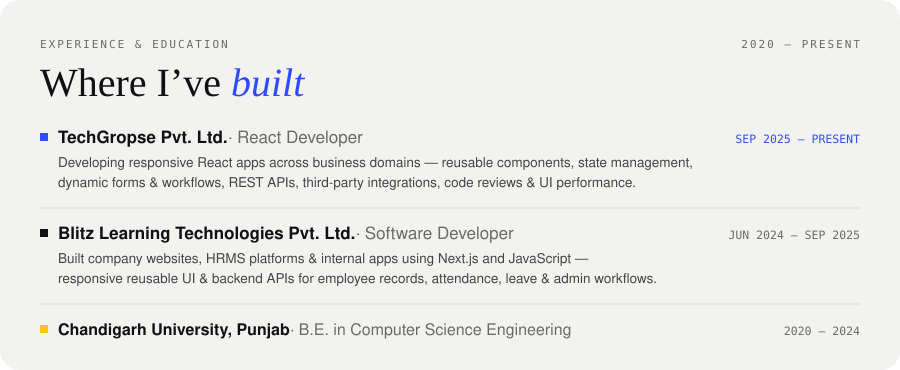
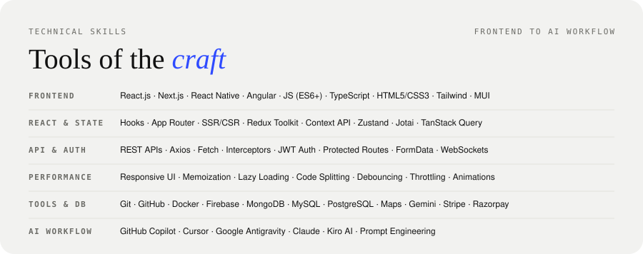
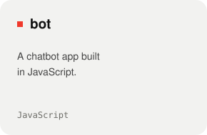
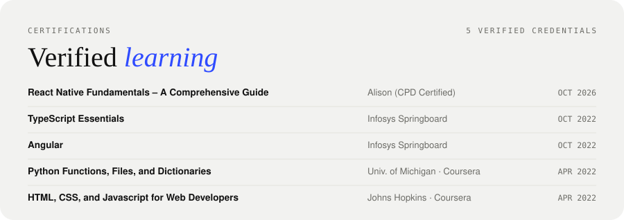

  <a href="https://nitshya.vercel.app/">official portfolio</a> /
  <a href="https://nityanand08.vercel.app/">dev portfolio</a> /
  <a href="https://nityanand-portfolio-netflix.vercel.app/">creative portfolio</a> /
  <a href="https://www.linkedin.com/in/nityanand-ba65bb1b7">linkedin</a> /
  <a href="mailto:royanand729@gmail.com">email</a>

